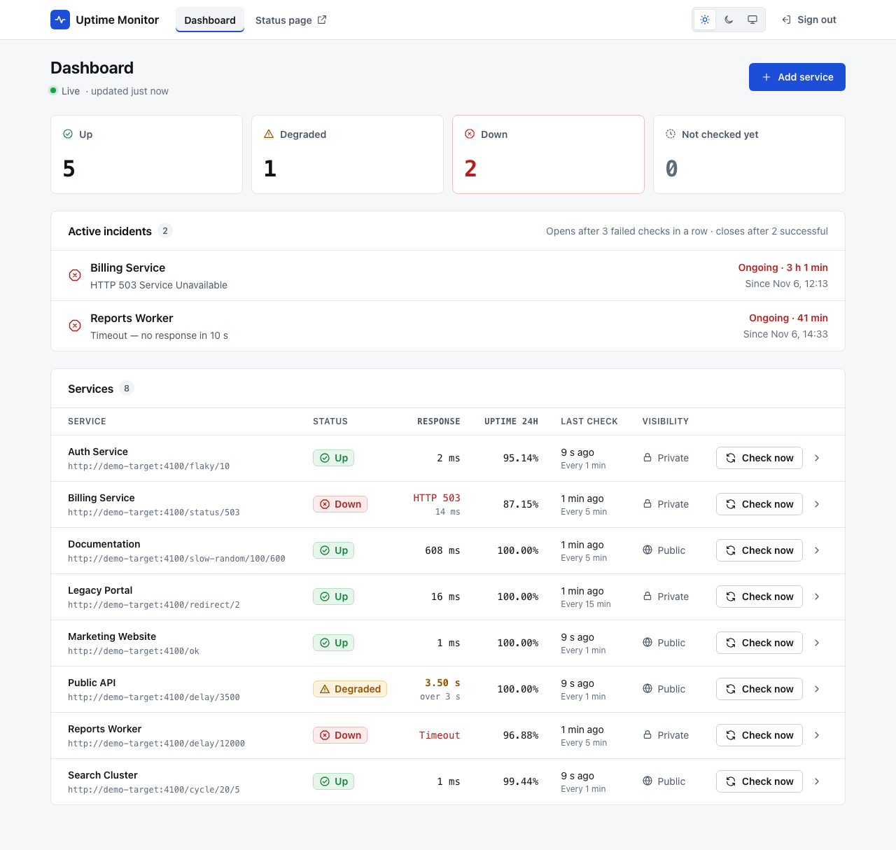
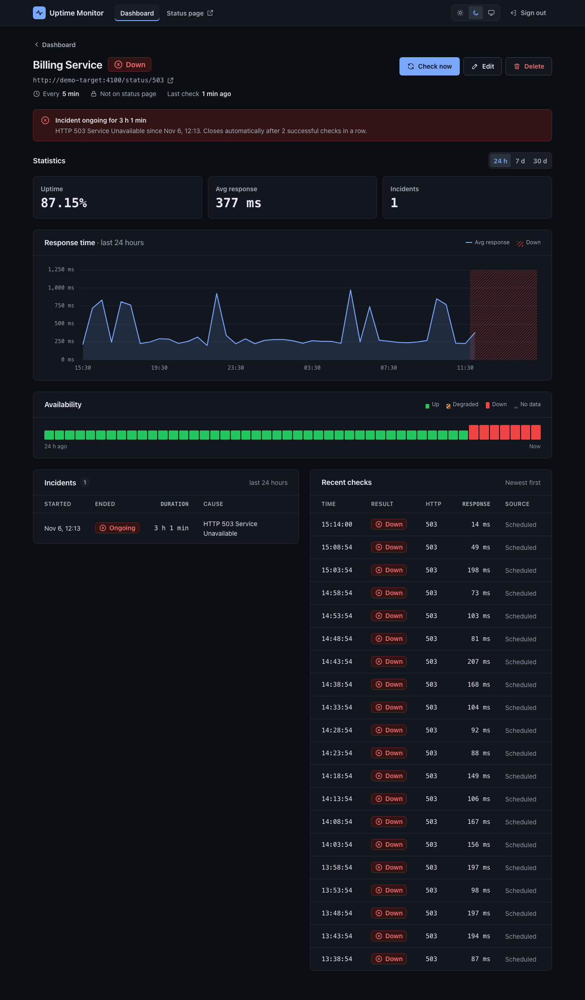
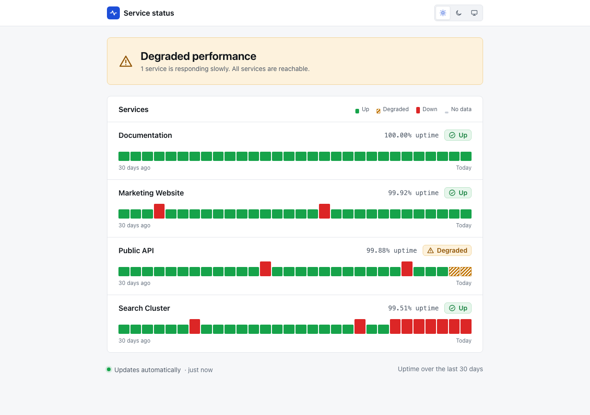
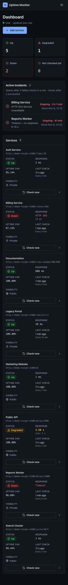

# Uptime Monitor

Self-hosted uptime monitoring for HTTP(S) services, built with Elixir and
Phoenix. It checks your endpoints on a schedule, opens and resolves incidents
automatically, keeps 30 days of history with uptime and response-time
statistics, and publishes a public status page for the services you choose.



| Service details (dark) | Public status page | Mobile |
|---|---|---|
|  |  |  |

## Features

- **Services** — name, HTTP(S) URL, check interval (1, 5, 15, 30 or 60 min),
  public/private flag. Create, edit, delete.
- **Checks** — 10 s timeout. HTTP 2xx/3xx = success; 4xx/5xx, timeout, DNS and
  connection/TLS errors = failure. A successful response slower than 3 s is
  **Degraded** (still counts as available).
- **Incidents** — opened after 3 consecutive failed checks, resolved after 2
  consecutive successful ones. Each incident stores its reason, start (first
  failed check) and end (first successful check).
- **Check Now** — an immediate unscheduled check of a service.
- **Statistics** for 24 h, 7 d and 30 d — uptime %, average response time,
  incident count, response-time chart data and availability history.
- **Retention** — checks are kept for 30 days, resolved incidents for 90 days;
  cleaned up automatically every hour.
- **Real-time** — Phoenix PubSub events after every check, status change,
  incident and service change, for the admin UI and the public status page.
- **Public status page data** — only services flagged as public, without URLs
  or internal error details.
- **SSRF protection** — monitored URLs cannot target private, loopback,
  link-local (incl. cloud metadata), multicast or reserved addresses.
- **Single administrator** — email + password login, no registration.

## Screens

| URL | Screen |
|-----|--------|
| `/login` | Sign in (administrator) |
| `/admin` | Dashboard: Up / Degraded / Down / Not checked yet summary, active incidents, services table with Check now, live indicator |
| `/admin/services/:id` | Service details: status, Check now / Edit / Delete, ongoing incident, 24 h / 7 d / 30 d statistics, response-time chart, availability bars, incidents, recent checks |
| `/admin/services/new`, `/admin/services/:id/edit` | Add / Edit service (server-side validation including SSRF rules) |
| `/status` (and `/`) | Public status page — no login, only public services, no URLs |

- **Real time:** LiveView pages subscribe to the Phoenix PubSub events; the
  public page uses only the public topic. When the live connection drops, the
  admin pages show *Connection lost. Reconnecting…* until it is back.
- **Themes:** light, dark or system (default). A manual choice overrides the
  system setting, is stored in `localStorage` and applied before the first
  paint. Layouts: mobile < 768 px (menu sheet), tablet 768–1023 px, desktop.
- **Times** are shown in the browser's time zone (`Nov 5, 14:02`); relative
  times (`24 s ago`) and running incident durations update every second.
- The UI follows the approved design (tokens and component styles in
  `assets/css/app.css`); the chart uses Chart.js 4 (vendored in
  `assets/vendor`, bundled by esbuild — no CDN).

## Tech stack

Elixir 1.20 · Phoenix 1.8 · LiveView 1.2 · Tailwind CSS 4 · Chart.js 4 · Oban ·
Req (with a Mint-based adapter) · PostgreSQL + Ecto · Phoenix PubSub · ExUnit ·
Playwright · Docker Compose.

## Quick start (Docker Compose)

Requirements: Docker with Compose v2.

```sh
docker compose up --build
```

This starts three containers:

| Service       | Purpose                                                   |
|---------------|-----------------------------------------------------------|
| `db`          | PostgreSQL 17                                             |
| `demo-target` | Test HTTP service used as the monitoring target           |
| `app`         | Uptime Monitor at <http://localhost:4000> (public status page; admin at `/admin`) |

On first start the app automatically runs migrations, creates the admin
account and seeds demo data (8 services with 30 days of check history and
incidents). Scheduled checks of the demo services start within a minute.

### Demo login

| Email               | Password           |
|---------------------|--------------------|
| `admin@example.com` | `uptime-demo-2026` |

Log in at <http://localhost:4000/login>. These are demo-only credentials; set
`ADMIN_EMAIL` / `ADMIN_PASSWORD` in `.env` before the first start to use your
own (they are applied only when no admin exists yet).

### Configuration

Copy `.env.example` to `.env` to override defaults (port, host, secret key,
admin credentials, database password). Without `SECRET_KEY_BASE` an ephemeral
key is generated at each start, which logs you out on restart.

To start over with a clean database: `docker compose down -v`.

## Demo services and the test HTTP service

The `demo-target` container runs `UptimeMonitor.Demo.Target`, a small Plug
application that reproduces typical endpoint behaviour without external
websites:

| Path                          | Behaviour                                              |
|-------------------------------|--------------------------------------------------------|
| `/ok`                         | 200 OK                                                 |
| `/status/:code`               | responds with the given HTTP status                    |
| `/delay/:ms`                  | waits, then 200 (`?status=500` to fail slowly)         |
| `/redirect/:n`                | chain of `n` redirects ending in 200                   |
| `/redirect-to?url=...`        | redirect to any URL                                    |
| `/redirect-loop`              | endless redirect loop                                  |
| `/flaky/:percent`             | random HTTP 500 in `percent` % of requests             |
| `/cycle/:up/:down`            | 200 for `up` minutes, then 503 for `down` minutes      |
| `/slow-random/:min/:max`      | 200 after a random delay                               |

Seeded demo services:

| Service           | Target                  | Interval | Public | Live state        |
|-------------------|-------------------------|----------|--------|-------------------|
| Marketing Website | `/ok`                   | 1 min    | yes    | Up                |
| Public API        | `/delay/3500`           | 1 min    | yes    | Degraded (> 3 s)  |
| Billing Service   | `/status/503`           | 5 min    | no     | Down (incident)   |
| Search Cluster    | `/cycle/20/5`           | 1 min    | yes    | periodic outages  |
| Auth Service      | `/flaky/10`             | 1 min    | no     | mostly Up, flaky  |
| Legacy Portal     | `/redirect/2`           | 15 min   | no     | Up via redirects  |
| Reports Worker    | `/delay/12000`          | 5 min    | no     | Down (timeout)    |
| Documentation     | `/slow-random/100/600`  | 5 min    | yes    | Up                |

Seeding is skipped when any service already exists, so restarts keep your data.

## SSRF protection and the allowlist

Every URL is validated when a service is saved and again before every request:

- only `http` and `https`; no credentials in the URL;
- the host is resolved and **every** returned address must be allowed —
  blocked ranges include `0.0.0.0/8`, `10/8`, `100.64/10`, `127/8`,
  `169.254/16` (incl. `169.254.169.254`), `172.16/12`, `192.168/16`,
  documentation/benchmark ranges, multicast, `240/4`, broadcast, and the IPv6
  equivalents (`::`, `::1`, `fc00::/7`, `fe80::/10`, `ff00::/8`, NAT64, 6to4,
  Teredo, documentation) and all IPv4-mapped IPv6 addresses (`::ffff:0:0/96`);
- the request is sent to the already validated IP (the name is not resolved
  again), with the original host name used for `Host`, TLS SNI and
  certificate verification — this prevents DNS rebinding;
- redirects are followed manually, at most 5, and each hop is validated the
  same way.

A forbidden URL is rejected with a validation error when saving; during a
check it produces a failed check with the reason.

Private addresses can be allowed **only explicitly** with the `SSRF_ALLOWLIST`
environment variable: a comma-separated list of host names (exact match),
IP addresses or CIDR ranges. It is **empty by default**. The Docker Compose
demo sets `SSRF_ALLOWLIST=demo-target` so that only the demo target service
(which has a private Docker network address) can be monitored.

## Local development

Requirements: Elixir 1.20 / OTP 29, PostgreSQL 14+.

```sh
mix setup                       # deps, database, assets
mix uptime.admin admin@example.com   # create the admin (prompts for a password,
                                     # or reads ADMIN_PASSWORD)
mix phx.server                  # http://localhost:4000
```

Database connection settings default to `postgres:postgres@localhost:5432` and
can be changed with `POSTGRES_USER`, `POSTGRES_PASSWORD`, `POSTGRES_HOST` and
`POSTGRES_PORT`.

Optional local demo data:

```sh
mix uptime.demo_target                        # terminal 1, port 4100
SSRF_ALLOWLIST=localhost mix run priv/repo/seeds.exs
SSRF_ALLOWLIST=localhost mix phx.server       # allow checks of the local target
```

`mix uptime.admin EMAIL` can also be used later to change the admin email or
password; all sessions are revoked. Passwords are stored only as bcrypt hashes.

## Running tests

### ExUnit

```sh
mix test
```

Tests need PostgreSQL (same `POSTGRES_*` variables as above). They use a stub
DNS resolver and start the demo target on `127.0.0.1` with a random port, so no
network access is required. LiveView tests cover every screen. `mix precommit`
additionally checks that the code compiles without warnings and is formatted.

### Playwright (end-to-end)

Requirements: Node.js 20+, PostgreSQL (same `POSTGRES_*` variables), Elixir.

```sh
cd e2e
npm ci --include=dev            # installs @playwright/test
npx playwright install chromium # once
npm test                        # end-to-end tests
npm run screenshots             # optional: screens and states → e2e/artifacts/screenshots
```

The screenshot run restores the plain demo data first, so it does not depend
on what the end-to-end tests created. The README images in `docs/screenshots`
come from the Docker Compose demo itself: start it with `docker compose up`
(clean volume) and run `npm run readme-screenshots`.

Playwright starts its own server (`e2e/scripts/server.sh`): a fresh
`uptime_monitor_e2e` database, the demo target on port 4110, demo data, an
administrator `e2e@example.com` and the app on <http://localhost:4010>, with
`SSRF_ALLOWLIST=localhost`. Ports can be changed with `E2E_PORT` and
`E2E_TARGET_PORT`. The tests cover sign-in (success and errors), protected
admin routes, service create/edit/delete including the SSRF rejection, Check
now, the period switch, the public page (no private services, no URLs), theme
switching with persistence, the mobile menu, real-time updates across tabs and
the reconnecting banner, no horizontal overflow at 768/834/1024 px, the
number of recent checks per width and round chart axis steps.

### Continuous integration

A GitHub Actions workflow is prepared in `.github/workflows/ci.yml`: compile
with `--warnings-as-errors`, `mix format --check-formatted` and `mix test`
against a PostgreSQL service, then the Playwright end-to-end tests. It is
**disabled** — it runs only when started manually (Actions → CI → Run
workflow). To run it on every push to `main` and on pull requests, uncomment
the `push` and `pull_request` triggers at the top of the workflow file.

## Metrics

- **Uptime %** — `(up + degraded) / all checks × 100` in the period, including
  Check Now checks; empty when there are no checks.
- **Average response time** — mean of successful (up and degraded) checks
  only; failed checks are excluded.
- **Incident count** — incidents overlapping the period (started before its
  end and still open or resolved after its start).
- **Chart / availability slots** — 24 h: 48 × 30 min (from raw checks);
  7 d: 42 × 4 h and 30 d: 30 × 1 day (from hourly rollups); the public page
  shows the 30 daily slots. Slots are aligned to the viewer's local time and
  the last slot contains the current time. The chart plots each slot's
  average successful response time (gaps where a slot has none). Slot status
  for the bars and the hatched chart bands:
  - **Down** — an incident (confirmed downtime) overlaps the slot; the tooltip
    shows how long;
  - **Degraded** — no incident and the average successful response time is
    above 3 s;
  - **Up** — checks exist, no incident, normal response time;
  - **No data** — no checks.

  A single failed check that does not open an incident does not turn a slot
  red; it lowers the slot's uptime %, shown in the tooltip.
- **Public overall status** — every checked public service down → *Major
  outage*; at least one down → *Partial outage*; none down, some degraded →
  *Degraded performance*; otherwise *All systems operational*. Services that
  have never been checked show *No data* and do not affect it.

7 d / 30 d statistics read pre-aggregated hourly rollups (maintained on every
check) instead of raw checks, so a 1-minute service (43 200 checks per 30 days)
needs at most 720 rows per query.

## Project structure

```
lib/uptime_monitor/
  accounts.ex, accounts/            single admin, bcrypt, session tokens
  monitoring.ex                     services, checks, incidents, Check Now
  monitoring/
    url_guard.ex, ip_ranges.ex      SSRF validation
    resolver.ex, resolver/inet.ex   DNS resolution (pluggable for tests)
    http_check.ex, http_adapter.ex  check execution (Req + Mint adapter)
    incident_tracker.ex             3-failures / 2-successes state machine
    stats.ex                        24 h / 7 d / 30 d statistics
    retention.ex                    30 / 90 day cleanup
    events.ex, public_view.ex       PubSub events and public projections
    workers/                        Oban: scheduler, check, cleanup
  status_page.ex                    public status page data
  demo/target.ex, demo/seeder.ex    test HTTP service and demo data
  release.ex                        release setup (migrate, admin, seed)
lib/uptime_monitor_web/
  live/                             Dashboard, Service details, Service form, Status page
  components/                       layouts (admin, public, sign-in) and UI components
  controllers/                      sign-in / sign-out, health check
  admin_auth.ex, time_zone.ex       session auth, browser time-zone offset
  format.ex                         date, duration and number formatting
assets/
  css/app.css                       design tokens + component styles (Tailwind 4)
  js/app.js, js/response_chart.js   theme, dialogs, live times, Chart.js hook
  vendor/chart.umd.min.js           Chart.js 4.6.1 (MIT)
priv/repo/migrations/               database schema
rel/overlays/bin/                   docker-entrypoint, demo-target scripts
test/                               ExUnit tests (contexts, LiveViews, controllers)
e2e/                                Playwright tests, screenshot capture, e2e server
```

### Scheduling

An Oban cron job runs every minute, locks services whose `next_check_at` is due
(`FOR UPDATE SKIP LOCKED`), enqueues one check job per service and advances
`next_check_at`. Check jobs are unique per service while pending or running.
All state is in PostgreSQL, so checks are neither duplicated nor lost across
restarts: overdue services are checked once on the first tick after start, and
orphaned jobs are rescued by Oban's Lifeline plugin.

## License

Released under the [MIT License](LICENSE). Chart.js (bundled in
`assets/vendor`) is MIT-licensed as well, see
`assets/vendor/chart.js.LICENSE.md`.
